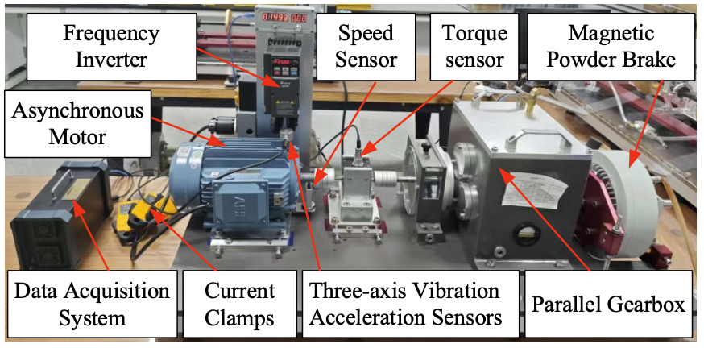

# Motor Fault Detection

This project is designed to work exclusively with DEEPCRAFT™ Studio. Download it from [here](https://softwaretools.infineon.com/assets/com.ifx.tb.tool.deepcraftstudio).

## Overview - Use-Case

- **Problem:** Real-time detection of various different types of motor faults.
- **Machine learning method:** CNN classification 
- **Sensor and data:** Torque, speed, vibration and current
- **Relevance:** Detect and accurately label several types of motor faults, including when those faults co-exist. 

## Contents

`Data` — Downsampled, 640 Hz sessions, each labeled with by class. These classes may be multi-modal, compound issues - e.g, `static_eccentricity` and `bearing`. This is labeled as `static_eccentricity_and_bearing`. The original dataset contained 24 labels and these were winnowed down to 12 by combining those with similair issues, e.g `bearing_inner_L` -> `bearing` (for a full list of these mappings consult the `clean_data.py` script).These modifications were done using the script `clean_data.py` contained within the `Resources` subfolder; `Scripts`.


`Models` — Folder where the trained DEEPCRAFT model, predictions, and generated Edge code are saved

`Resources` — [`original_names.csv`](Resources/original_names.csv) and [`new_names.csv`](Resources/new_names.csv) for arc-test name mapping, plus photographs of the arcing setup and load simulator in `Resources/Images/`

## Sensor(s) & Data

The dataset (available [here](https://huggingface.co/datasets/Samlzy/MCC5-THU-Motor)) is a comprehensive collection of motors with up to two different kind of faults simultaneously - both mechanical and electrical. Each session is made up of eight different signals - torque, speed, triaxial vibration and three phase current. There are also two different sets of data present within the dataset. One where the speed was kept constant at 1000 rpm or 3000 rpm and the other set where torque was kept constant at either 20 Nm or 40 Nm. Each sample is 90 seconds long.


**Setup**




### Data specifications

**Input features (`data.data`)**

| Field | Description |
| --- | --- |
| `time` | Timestamp (seconds) |
| `speed` | Motor speed |
| `torque` | Torque (Nm) |
| `motor_vibration_X` | Vibration acceleration (0.1g) |
| `motor_vibration_Y` | Vibration acceleration (0.1g) |
| `motor_vibration_Z` | Vibration acceleration (0.1g) |
| `motor_current_A` | Current (0.1A) |
| `motor_current_B` | Current (0.1A) |
| `motor_current_C` | Current (0.1A) |


**Target variable (`label.label`)**

| Field | Description |
| --- | --- |
| `Time (Seconds)` | Timestamp of the beginning of the label (seconds) |
| `Length` | Duration of the label (seconds) |
| `Label` | 1 of 12 available labels. See list of possible labels below |
| `Comment` | Optional notes for the sample |

| Class | Number of Samples |
| --- | --- |
| `bearing` | 84 |
| `bend` | 12 |
| `broken_bar` | 12 |
| `broken_bar_and_bearing` | 24 |
| `dynamic_eccentricity` | 12 |
| `dynamic_eccentricity_and_bearing` | 24 |
| `static_eccentricity` | 24 |
| `static_eccentricity_and_bearing` | 24 |
| `voltage_unbalance_L` | 6 |
| `winding` | 24 |
| `winding_and_bearing` | 24 |
| `unlabeled`| 12 |


**Sampling**

- Original sampling rate: 12.8 kHz
- Sampling rate of the provided data: 640 Hz

**Files**

- **282** paired sessions in total (`.data` input + `.label` target)
- Format: CSV-style `.data` (input) and `.label` (target) files

### Data attribution

The dataset is an open dataset authored by Shijin Chen and Zeyi Liu and Chenyang Li and Dongliang Zou and Xiao He and Donghua Zhou [[1]](#citations). Use of this accelerator through DEEPCRAFT™ Studio is subject to Infineon’s [Studio terms and conditions](https://developer.imagimob.com/legal/studio-terms-and-conditions). This data is provided with the CC 4.0 license.

## Adding More Data

Expand the dataset with additional sessions that match this project’s format. Place new sessions under `Data/[label]` with `label` corresponding to the label of your choice. Consult the original dataset authors' methods [here](https://arxiv.org/abs/2601.02278).


## Steps to Production

Bring this classifier from an accelerator to a product by increasing the amount of data in the dataset. There seems to be particular issues amongst the `bend` and `broken_bar` labels. With enough extra data it may be possible too to disaggregate the labels and return them to their original scheme.

**Increase data variability**

- Current status: 282 sessions .
- Collect data with faults within the the least performing classes, i.e - `broken_bar`.
- Record more negative data of a healthy motor to ensure few false positives.
- Prefer real transients (startup, shutdown, load steps) over only steady-states.

**Train / validation / test split**

- Keep the **test set** off sessions that appear in train or validation.
- Put both healthy and faulty motor examples in the test set, wfith varying torque and/or speed values that were not used in training, so you can check generalization.

**Negative data and robustness**

- Keep a large healthy motor set 
- Validate on different motors than the ones used for training.

**Edge deployment**

- Memory: keep the model small enough for the target Infineon MCU.
- Inference speed: real-time motor fault detection at 1hz
- Power: efficient inference for always-on monitoring.

**Safety and validation**

- Set accuracy / false-negative and false-positive thresholds that match the product safety case.
- Commission against the physical current sensor on the production hardware.
- Define how the model will be updated after new field or lab data.

---

## Attribution & Citation

<a name="citations"></a>

```bibtex
@article{Chen2026MotorDataset,
  title   = {Multi-mode Fault Diagnosis Datasets of Three-phase Asynchronous Motor Under Variable Working Conditions},
  author  = {Shijin Chen and Zeyi Liu and Chenyang Li and Dongliang Zou and Xiao He and Donghua Zhou},
  journal = {arXiv preprint arXiv:2601.02278},
  year    = {2026}
}
```

## Getting Started

Please visit [developer.imagimob.com](https://developer.imagimob.com), where you can read about DEEPCRAFT™ Studio and go through step-by-step tutorials to get you quickly started.

For object-detection data formats, see [Bring your own data for object detection projects](https://developer.imagimob.com/deepcraft-studio/data-preparation/bring-your-data/bring-your-own-data-object-detection).


## Help & Support

If you need support or if you want to know how to deploy the model onto the device, please submit a ticket on the Infineon [community forum](https://community.infineon.com/t5/Imagimob/bd-p/Imagimob/page/1) DEEPCRAFT™ Studio page.