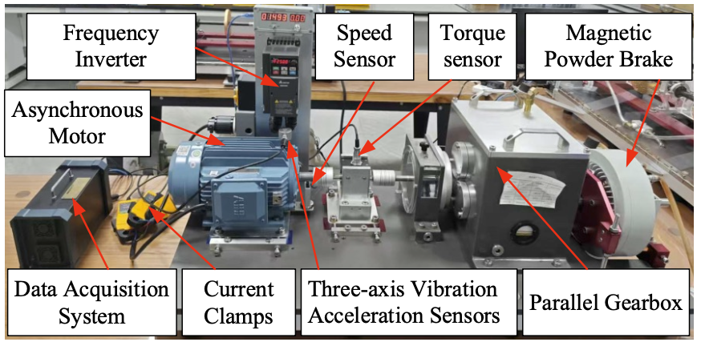

# Motor Fault Detection

This project is designed to work exclusively with DEEPCRAFT™ Studio. Download it from [here](https://softwaretools.infineon.com/assets/com.ifx.tb.tool.deepcraftstudio).

## Overview - Use-Case

The **Motor Fault Detection** Accelerator trains a classifier on one 2.2 kW three-phase induction motor. It separates a healthy motor from 11 fault classes. Some classes are two faults at once, such as a winding fault together with a bearing defect.

Healthy recordings use Studio's `unlabeled` class. In this project, `unlabeled` means a healthy motor.

- **Problem:** Real-time detection of various different types of motor faults.
- **Machine learning method:** CNN classification
- **Sensor and data:** Key-phase, torque, triaxial vibration, and three-phase current from the MCC5-THU rig, stored at 640 Hz
- **Relevance:** Detect and accurately label several types of motor faults, including when those faults co-exist.

## Contents

**`Data`** — 282 sessions at 640 Hz. Each fault session has one label covering the whole recording. A recording with two faults keeps a joined name, so static eccentricity together with a bearing defect is `static_eccentricity_and_bearing`. The source collection has 24 labels. This project keeps 12 classes by merging labels that differ only by severity or by which bearing surface is damaged. For example, `bearing_inner_L` and `bearing_outer_H` both become `bearing`. Healthy recordings stay in `Data/health` and use `unlabeled`.

The merge and the conversion to Studio sessions are done by [`Resources/Scripts/clean_data.py`](Resources/Scripts/clean_data.py). Original filenames are listed in [`Resources/file_mappings.csv`](Resources/file_mappings.csv).

**`Models`** — Folder where the trained DEEPCRAFT model and its predictions are saved

**`PreprocessorTrack`** — Folder where preprocessed data is saved.

**`Resources`** — [`file_mappings.csv`](Resources/file_mappings.csv) maps each source CSV to its session folder. [`Scripts/clean_data.py`](Resources/Scripts/clean_data.py) converts the source CSVs into Studio sessions. `Images/image.png` is the motor test-rig photograph from the source paper.

## Sensor(s) & Data

The sessions are prepared from the [MCC5-THU motor fault dataset](https://data.mendeley.com/datasets/6s3dggj9mw/1) (DOI [10.17632/6s3dggj9mw.1](https://doi.org/10.17632/6s3dggj9mw.1)), described by Chen, Liu, Li, Zou, He, and Zhou [[1]](#citations).

Each source recording is one 90 s run on a single 2.2 kW three-phase induction motor, with up to two faults present at once. Eight signals were sampled together at 12.8 kHz: a key-phase pulse, shaft torque, vibration on three axes at the drive end, and current on the three motor phases. This project keeps every 20th sample, so the files in `Data/` are 640 Hz, 57,600 rows, and end at 89.9984375 s. No low-pass filter was applied before keeping those samples. Aliasing means that anything in those signals faster than 320 Hz (half of 640 Hz) is folded into the slower recording and can no longer be separated from a real slow change. The paper recorded at 12.8 kHz so those faster fault frequencies would still be in the source files.

The source uses two operating modes. Both the torque level and the speed number appear in every filename. The word `speed_circulation` or `torque_circulation` says which quantity moves during the run. The speeds below were measured from the key-phase pulse spacing, counted as one pulse per revolution, on the committed files.

- **`speed_circulation`.** Shaft speed changes during the 90 s. Torque stays in a narrow band. On a file named `20Nm_1000rpm`, the pulse rate moved between about 480 and 985 rpm while the torque column stayed near 0.20. On a file named `20Nm_3000rpm`, the pulse rate moved between about 2560 and 2954 rpm while torque stayed near −0.25.
- **`torque_circulation`.** Shaft speed stays near the named rpm and the torque column moves. On a file named `20Nm_1000rpm`, the pulse rate stayed near 985 rpm. On a file named `40Nm_3000rpm`, it stayed near 2954 rpm while torque moved.

A full source label has 12 runs: six `speed_circulation` and six `torque_circulation`. A few labels are short of that or have one extra run, and that is why the class sizes below are uneven. `voltage_unbalance_L` has only the six `torque_circulation` runs, so that class has no variable-speed recordings. `bearing_inner_H` has no `speed_circulation` run at 20 Nm and 3000 rpm (11 runs). `bearing_outer_H` has two recordings of `speed_circulation` at 20 Nm and 3000 rpm, `250707105700` and `250821110519` (13 runs). Those gaps and the extra run are why `bearing` has 84 sessions and `voltage_unbalance_L` has 6.

**Setup**



The photograph is Figure 1 of Chen et al. [[1]](#citations), reused under [CC BY 4.0](https://creativecommons.org/licenses/by/4.0/).

### Signals used for training

The model is trained on eight synchronized channels recorded from four sensor groups:

- **Key-phase pulse (`speed`):** A once-per-revolution reference voltage pulse (rising to ~4 V). It indicates shaft rotation frequency and angular position, allowing algorithms to track speed changes and isolate rotation-dependent fault frequencies.
- **Input shaft torque (`torque`):** Torsional load measured on the gearbox input shaft. Dynamic torque variations capture load fluctuations, mechanical resistance changes, and torsional vibrations caused by drive-train defects.
- **Triaxial vibration (`motor_vibration_X`, `motor_vibration_Y`, `motor_vibration_Z`):** Acceleration measured along horizontal radial, axial, and vertical radial axes at the drive end. Vibration signals capture mechanical defects: impact shocks from bearing raceway pitting or ball damage, axial vibration from bent shafts, and rotational harmonics from rotor eccentricity.
- **Three-phase stator current (`motor_current_A`, `motor_current_B`, `motor_current_C`):** Instantaneous phase currents measured with current clamps. Current waveforms capture electromagnetic anomalies: stator winding short circuits alter phase balance and impedance, broken rotor bars produce characteristic sidebands around the electrical supply frequency, and voltage unbalance distorts three-phase current symmetry.

Combining complementary modalities (electrical currents for electromagnetic anomalies, vibration for mechanical impacts and kinematics, torque and key-phase for operational context) enables the classifier to separate overlapping single and compound faults.

### Data specifications

The stored numbers are raw acquisition voltages, not converted units. The sensitivities the authors used for conversion are 100 mV/N·m for torque, 100 mV/g for vibration, and 100 mV/A for current [[1]](#citations).

The model in this project is trained on these raw voltages. The torque sensitivity does not recover the N·m in the filename: a recording named 20 Nm sits near 0.2 V, about 2 N·m, and one named 40 Nm sits near 0.5 V, about 5 N·m. That name is the brake load on the gearbox output shaft, and the sensor measures the input shaft. The same group's gearbox dataset gives that path a factor of about 6, which still falls short of 20 and 40, and about a third of the sessions at each setting read negative [[2]](#citations).

**Input features (`data.data`)**

| Field | Description |
| --- | --- |
| `time` | Sample time (seconds), starting at 0 with a step of 1/640 s |
| `speed` | Motor key-phase signal. The name is the source column name. It is not rotational speed in rpm |
| `torque` | Torque-sensor voltage on the gearbox input shaft. See the scale note above |
| `motor_vibration_X` | Drive-end vibration, horizontal radial |
| `motor_vibration_Y` | Drive-end vibration, axial |
| `motor_vibration_Z` | Drive-end vibration, vertical radial |
| `motor_current_A` | Phase A current-clamp voltage |
| `motor_current_B` | Phase B current-clamp voltage |
| `motor_current_C` | Phase C current-clamp voltage |

Healthy sessions live in `Data/health`. Their label file is the header only, so Studio reads the session as `unlabeled`.

| Class | Folder | `speed_circulation` | `torque_circulation` | Sessions |
| --- | --- | --- | --- | --- |
| `bearing` | `Data/bearing` | 42 | 42 | 84 |
| `bend` | `Data/bend` | 6 | 6 | 12 |
| `broken_bar` | `Data/broken_bar` | 6 | 6 | 12 |
| `broken_bar_and_bearing` | `Data/broken_bar_and_bearing` | 12 | 12 | 24 |
| `dynamic_eccentricity` | `Data/dynamic_eccentricity` | 6 | 6 | 12 |
| `dynamic_eccentricity_and_bearing` | `Data/dynamic_eccentricity_and_bearing` | 12 | 12 | 24 |
| `static_eccentricity` | `Data/static_eccentricity` | 12 | 12 | 24 |
| `static_eccentricity_and_bearing` | `Data/static_eccentricity_and_bearing` | 12 | 12 | 24 |
| `voltage_unbalance_L` | `Data/voltage_unbalance_L` | 0 | 6 | 6 |
| `winding` | `Data/winding` | 12 | 12 | 24 |
| `winding_and_bearing` | `Data/winding_and_bearing` | 12 | 12 | 24 |
| `unlabeled` | `Data/health` | 6 | 6 | 12 |
| **Total** | | **138** | **144** | **282** |

`voltage_unbalance_L` keeps its source severity suffix because the source has no high-severity run to merge with it.

### What each fault is

A healthy motor is the `unlabeled` class. The other eleven names are faults that were built into this one machine. The faults were physically introduced, for example by precision machining or laser etching, so each fault condition is controllable and repeatable ([MCC5-THU Motor Benchmark Datasets](https://github.com/liuzy0708/MCC5-THU-Motor-Benchmark-Datasets)). Several names are two faults at once. Current carries the electromagnetic faults and vibration carries the mechanical ones. Torque and the key-phase pulse are the operating context for every class.

| Class | Physical type | What it means |
| --- | --- | --- |
| `unlabeled` | Healthy | Healthy motor. No fault was introduced |
| `bearing` | Mechanical | Damage on a bearing race or on a ball. Light and severe inner, outer, and ball faults are merged into this one class |
| `bend` | Mechanical | The shaft is bent, so the rotating load wobbles |
| `broken_bar` | Electromagnetic | Bars in the rotor cage are open. The source experiment removed three bars in a row |
| `static_eccentricity` | Mechanical | The rotor is off center and the narrow part of the air gap stays in one place. Light and severe offsets are merged |
| `dynamic_eccentricity` | Mechanical | The rotor is off center and the narrow part of the air gap travels around as the shaft turns |
| `winding` | Electromagnetic | Some turns in a stator winding touch, so that phase no longer matches the others. Light and severe shorts are merged |
| `voltage_unbalance_L` | Electromagnetic | The three supply phases are unequal. The motor hardware can be healthy. Only the light severity is in the source set |
| `broken_bar_and_bearing` | Electromagnetic and mechanical | Open rotor bars and a bearing defect together |
| `static_eccentricity_and_bearing` | Mechanical | A fixed off-center rotor and a bearing defect together |
| `dynamic_eccentricity_and_bearing` | Mechanical | A rotating off-center gap and a bearing defect together |
| `winding_and_bearing` | Electromagnetic and mechanical | A winding short and a bearing defect together |

### Train, validation, and test

The project file puts 166 sessions in train, 58 in validation, and 58 in test (about 60% / 20% / 20%). Sessions from the same fault and the same named operating condition often appear in more than one of those splits. The test split is another slice of this rig, including settings that training has already seen. It is not a second motor, and it is not a held-out speed or torque profile.

### Data attribution

The `Data/` sessions are derived from the Mendeley deposit cited below. License: [Creative Commons Attribution 4.0 International (CC BY 4.0)](https://creativecommons.org/licenses/by/4.0/). Commercial use and model training are allowed. You must credit the authors, link the license, and state what was changed.

Use of this Accelerator through DEEPCRAFT™ Studio is also subject to Infineon’s [Studio terms and conditions](https://developer.imagimob.com/legal/studio-terms-and-conditions).

## Adding More Data

Add sessions in the same Studio shape: eight signal columns plus `time`, 640 Hz, and one of the class names in the table above. Put a fault session in `Data/<class>/` and write one label row covering the whole recording. Put a healthy session in `Data/health` and leave the label body empty so Studio keeps it as `unlabeled`.

The collection procedure for a new rig is the one in the source paper [[1]](#citations). Label new recordings in Studio, manually or with model assist, using these same class names. Keep an entire new motor out of training if the test is meant to measure a new machine.

## Target applications

The data comes from a 2.2 kW three-phase induction motor driving a two-stage parallel gearbox and a magnetic powder brake. This setup is typical of general industrial equipment rather than a passenger vehicle traction drive:

- **Industrial sites (Smart Manufacturing and Industrial IoT):** Three-phase induction motors are workhorses in factory floors, processing plants, pumping stations, ventilation fans, compressors, and material handling systems. The faults studied here are standard failure modes in industrial machinery.
- **Automotive and electric mobility:** While electric vehicles and industrial drives share fault mechanisms (such as bearing wear and winding insulation breakdown), automotive traction drives typically use permanent-magnet synchronous motors (PMSM) or interior PMSM with high-voltage inverters, different switching frequencies, and dynamic driving cycles. The machine learning methodology transfers, but the trained model cannot be directly deployed in an automotive drive without retraining on vehicle-specific motor data.
- **Deployment considerations:** Deployed industrial motors rarely feature dedicated torque sensors or key-phase pulse sensors on the shaft. Real-world condition monitoring systems predominantly rely on motor current signature analysis (MCSA) and vibration accelerometers. Adapting this Accelerator to a plant usually involves training a model on the subset of available sensors (e.g., three-phase current and vibration).

## Steps to Production

Bring this classifier from an Accelerator to a product by following the suggestions below.

**Increase data variability**

- Current status: 282 sessions from one motor, with the same sensors, gearbox, and brake. A score here does not say how the model behaves on another motor.
- Class sizes are uneven. `bearing` has 84 sessions, `bend`, `broken_bar`, and `dynamic_eccentricity` have 12, and `voltage_unbalance_L` has 6. Severity and bearing-surface labels were merged away. Collect more examples for the small classes. `voltage_unbalance_L` has no variable-speed runs.
- Record more healthy-motor sessions so `unlabeled` is large enough to limit false positives.
- The committed runs already move either speed or torque during the 90 s. A product still needs other motors, other sensors, and the transients that matter on that product, such as startup and shutdown.

**Train / validation / test split**

- The committed split does not hold out a motor or an operating condition. The same fault and the same speed or torque setting can sit in train and in test.
- For a new collection, put each motor in only one split. Hold out torque and speed profiles that were not used in training. Holding out a speed profile, a torque profile, or a machine is still to be done for the committed data.

**Negative data and robustness**

- Keep a large healthy-motor set.
- Validate on motors other than the one used for these 282 runs, with the same eight channels in the same order and the same voltage scale.

**Edge deployment**

- Memory: keep the model small enough for the target Infineon MCU.
- Sampling: the files were decimated to 640 Hz with no anti-alias filter, so anything above 320 Hz is folded into the data. Regenerate the files with a low-pass filter, or keep the 12.8 kHz rate, if content above 320 Hz matters on the product.
- On the device, feed the same eight channels, in the same order and the same scale used in `Data/`. There is no per-channel normalization in this project.

**Safety and validation**

- Set accuracy, false-negative, and false-positive thresholds that match the product safety case.
---

## Attributions & Citations

<a name="citations"></a>

The sessions in `Data/` are derived from the MCC5-THU collection deposited by Shijin Chen, Zeyi Liu, Chenyang Li, Dongliang Zou, Xiao He, and Donghua Zhou. Dataset DOI: [10.17632/6s3dggj9mw.1](https://doi.org/10.17632/6s3dggj9mw.1) (Mendeley Data, version 1, published 6 January 2026). Version 2 of the same deposit (1 September 2026) is also CC BY 4.0. License: [CC BY 4.0](https://creativecommons.org/licenses/by/4.0/). `Resources/Images/image.png` is the test-rig photograph from the same work, reused under that license.

```bibtex
@misc{chen2026mcc5thu,
  title        = {Multi-mode Fault Diagnosis Datasets of Three-phase Asynchronous Motor Under Variable Working Conditions},
  author       = {Chen, Shijin and Liu, Zeyi and Li, Chenyang and Zou, Dongliang and He, Xiao and Zhou, Donghua},
  year         = {2026},
  howpublished = {\url{https://data.mendeley.com/datasets/6s3dggj9mw/1}},
  note         = {License: CC BY 4.0. DOI: 10.17632/6s3dggj9mw.1. Accessed 2026-11-02.},
}
```

```bibtex
@article{Chen2026MotorDataset,
  title   = {Multi-mode Fault Diagnosis Datasets of Three-phase Asynchronous Motor Under Variable Working Conditions},
  author  = {Shijin Chen and Zeyi Liu and Chenyang Li and Dongliang Zou and Xiao He and Donghua Zhou},
  journal = {arXiv preprint arXiv:2601.02278},
  year    = {2026},
  url     = {https://arxiv.org/abs/2601.02278}
}
```

A companion dataset from the same test rig, focusing on gearbox faults (gear wear, pitting, tooth breakage, and intermediate shaft bearing faults), is available at [MCC5-THU-Gearbox-Benchmark-Datasets](https://github.com/liuzy0708/MCC5-THU-Gearbox-Benchmark-Datasets) and described by Chen et al. [[2]](#citations):

```bibtex
@article{chen2024gearbox,
  title   = {Multi-mode Fault Diagnosis Datasets of Gearbox Under Variable Working Conditions},
  author  = {Shijin Chen and Zeyi Liu and Xiao He and Dongliang Zou and Donghua Zhou},
  journal = {Data in Brief},
  volume  = {54},
  pages   = {110453},
  year    = {2024},
  doi     = {10.1016/j.dib.2024.110453},
  url     = {https://doi.org/10.1016/j.dib.2024.110453}
}
```

## Getting Started

Please visit [developer.imagimob.com](https://developer.imagimob.com), where you can read about DEEPCRAFT™ Studio and go through step-by-step tutorials to get you quickly started.

## Help & Support

If you need support or if you want to know how to deploy the model onto the device, please submit a ticket on the Infineon [community forum](https://community.infineon.com/t5/Imagimob/bd-p/Imagimob/page/1) DEEPCRAFT™ Studio page.
