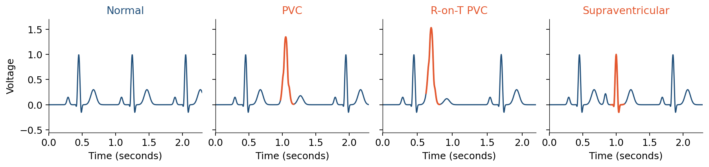
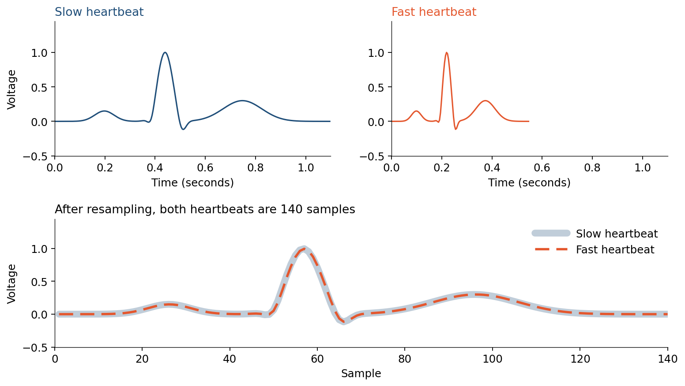

# Premature Heartbeat Detection

This project is designed to work exclusively with DEEPCRAFT™ Studio. Download it from [here](https://softwaretools.infineon.com/assets/com.ifx.tb.tool.deepcraftstudio)

> **Medical disclaimer:** This project, its associated components and any model trained with it are not medically certified or clinically validated by any medical regulatory authority.

## Overview - Use-Case

The **Premature Heartbeat Detection** accelerator is a binary time-series classifier for a single ECG lead which can detect the following classes:

- `unlabeled` — normal beats and background signals
- `premature_beat` — premature/ectopic beats of the following types: premature ventricular contraction (PVC), R-on-T PVC (a PVC that lands on the T wave of the previous beat), or supraventricular premature beat (an early beat that starts above the ventricles)

The drawing shows a normal heartbeat and the three premature heartbeats in this project. A PVC has a wide spike. An R-on-T PVC falls on the T wave of the heartbeat before it. A supraventricular beat is early and keeps a narrow spike. The model labels all three as `premature_beat`. This drawing is an illustration.



Frequent premature beats can cause palpitations, dizziness, and less effective pumping; a high PVC burden is associated with cardiomyopathy and heart-failure risk, and an R-on-T PVC can trigger a dangerous ventricular rhythm in a vulnerable heart. A clinic ECG often misses events that are infrequent or occur only during sleep, exercise, or stress. Running the detector on a wearable makes the difference because the lead is on the person all day, so sporadic premature beats can be screened as they happen instead of waiting for a short office recording.

This project is for a screening demonstration, **not a diagnostic device**. It shows that DEEPCRAFT™ Studio can be used to train a model that detects issues in an ECG signal. Premature beats are the example, use a similar Studio workflow to build a model for your specific use-case.

- **Problem:** Real-time screening of premature beats on a single ECG lead (normal/background vs premature morphology)
- **Machine learning method:** CNN binary classification (`unlabeled` vs `premature_beat`)
- **Sensor and data:** Single-lead ECG (PhysioNet BIDMC channel 0 at 250 Hz; ADC counts read by WFDB, then per-person z-score)
- **Relevance:** First-stage wearable or monitoring alarm after beat-aligned preprocessing; subtype diagnosis is left to a later stage or a clinician

### Why binary detection?

The original annotations distinguish several ectopic-beat families. This project collapses them into one `premature_beat` class for two reasons.

First, the intended use is a **first-stage screening** task: flag a beat as premature or not. Confusing one premature subtype with another matters less at that stage than missing a premature beat or alarming on a normal one. Subtype characterization can follow later, after a detection.

Second, a **clinician did not verify the labels**. The `.ecg` symbols come from an automated detector. Treating those symbols as a definitive rhythm diagnosis (PVC vs R-on-T vs supraventricular) would overstate what the annotations support. A binary screen is a more honest use of unverified targets.

Normal beats use Studio's built-in `unlabeled` background class. In this project, `unlabeled` means **normal/background by design**; it does not mean that the data is missing a label.

## Contents

**`Data`** — 602 packed, standardized sessions to import into Studio

**`Models`** — Trained DEEPCRAFT™ models, predictions, and generated Edge code

**`Resources`** — [`dataset_manifest.json`](Resources/dataset_manifest.json) (exact split membership and normalization statistics) and `Images/` (CM5 electrode diagram, heartbeat illustrations, and a raw `chf07` strip)

**`Tools`** — it contains scripts to rebuild dataset, on-device notes, and a preprocessor example [`ecg_preproc.h`](Tools/ecg_preproc.h) to adapt for firmware

## Sensor(s) & Data

The data used in this project is from a PhysioNet collection: all 15 recordings (`chf01`–`chf15`) of the [BIDMC Congestive Heart Failure Database v1.0.0](https://physionet.org/content/chfdb/). BIDMC is the Beth Israel Deaconess Medical Center, where the recordings were made; each one is about 20 hours of ECG from one patient with severe heart failure.

An ECG (electrocardiogram) is a plain analog measurement: the voltage between electrodes on the skin, which rises and falls as the heart beats. Here it is sampled at **250 Hz** on two channels. The files use the PhysioNet **WFDB** (WaveForm DataBase) format. A `.dat` file holds raw ADC counts. On these recordings the `.hea` header does not give a voltage gain, so WFDB uses its default of 200 counts per millivolt. The database page says the converter covers about ±10 mV. This project uses channel 0 only (the header name is `ECG1`). There is no other sensor.

A third file per record, `.ecg`, lists the time of every heartbeat and a symbol for its type (normal, premature ventricular contraction, supraventricular, and so on). These annotations come from an automated detector, not from a clinician, so the labels in `Data/` inherit that detector's possible mistakes. Auditing or relabeling beats raises the achievable accuracy.

### Recording setup (from PhysioNet)

The [PhysioNet database description](https://physionet.org/content/chfdb/1.0.0/) is the source for the acquisition settings.

| Item | Value |
|---|---|
| Subjects | 15 people with severe congestive heart failure, NYHA class III–IV: 11 men, ages 22–71; 4 women, ages 54–63 |
| Duration | about 20 hours per person |
| Signals | two ECG channels, recorded at the same time |
| Channel 0 (this project) | first signal in the `.hea` file, named **`ECG1`** |
| Channel 1 (not used) | second signal, named **`ECG2`** |
| Sample rate | 250 samples per second |
| Resolution and range | 12-bit, about ±10 mV |
| Analog bandwidth | about 0.1 Hz to 40 Hz |
| Recorder | ambulatory ECG recorder, Beth Israel Hospital (now Beth Israel Deaconess Medical Center) |
| Beat labels | `.ecg`, automated detector, not corrected by a clinician/doctor |

`ECG1` and `ECG2` are the two channels of the recorder. Each is the voltage between its own pair of skin electrodes, and both pairs were on the body at the same time, so the two traces are two views of the same heartbeats. The names are only file labels; they are not related to standard lead names. PhysioNet does not publish the exact electrode positions/sites.

The usual placement for a long recording meant to show premature beats is the bipolar chest lead **CM5** (also called modified V5). The two electrodes are:

- **Positive:** the **V5** spot on the left chest, just above the 5th rib space, on the anterior axillary line (the line down from the front of the armpit). This is the only V position used.
- **Negative:** the **upper sternum** (manubrium), in the midline at about the 2nd rib space. This is **not** V1, V2, or any other V spot. Those sit lower, along the 4th–5th rib spaces (see image below).

The line between the upper sternum and V5 crosses the heart, so a premature beat stands out on the trace. A ground electrode, if the recorder has one, can sit elsewhere on the torso. This is the standard described for lead CM5 and for channel 1 of a two-channel Holter.


**Note** Each beat on this pair has a sharp middle peak, called the QRS, produced when the ventricles contract. The outline of that peak follows where the electrodes sit. This project uses `ECG1`. A small shift of a similar chest pair changes the outline only a little. A different direction or a flipped pair changes the trace itself.

### Data insights: Baseline drift, noise bursts, downward peaks

The raw recordings are long ambulatory traces. Baseline drift, noise bursts, and saturation occur in separate portions of a recording. They do not affect every beat. Downward peaks are different: they can remain the usual shape for long portions of a recording. [Chen, Hao, Rakthanmanon, Zakaria, Hu, and Keogh (2015)](https://doi.org/10.1007/s10618-014-0388-4) reported baseline drift and noise on recording `chf07`. The strips in the image below are from the original file of that recording, channel `ECG1`, before the preparation steps in the next section.

- **Baseline Drift** The top strip is 12 seconds at minute 66. The orange line is a 1-second average. That average rises and then falls by much more than the height of a heartbeat. Breathing, small body movements, and a loose electrode can all shift the line this way. At the crest, near second 6, the trace reaches 554 counts. That is the highest value stored anywhere in this 20-hour file. For about half a second the dips shrink, because the recorder has no room left above that line. When the drift falls, the dips return. On every other recording the line also moves by more than one spike. How often that happens is in the table. `chf15` also reaches the top of its file, for about 0.8 seconds. See the table below for more details.

- **Noise Bursts** The bottom strip is 8 seconds at minute 676. The shaded part is about 4 seconds of fast noise. The heartbeats are hard to see there. After the shade ends, the spikes are clear again. In this recording those bursts are rare next to the 20 hours, and they come in separate stretches. The longest one found lasts about 11 seconds. On the other recordings the longest burst is about 6 seconds, and four recordings have no noise burst. See the table below for more details.

- **Downward Peaks** The sharp middle of a heartbeat can point down. In `chf07` that is the usual shape on `ECG1`: the dips in both strips are the heartbeats, and almost every normal beat points down. Across the other recordings, the share of normal beats that point down ranges from nearly all of them to nearly none. In several recordings one direction holds for a long stretch, then changes. The table counts normal beats. Premature beats can point down as well. On `chf02`, almost every premature beat points up. See the table below for more details.


The table below lists baseline drift, noise bursts, and downward peaks for all patients: `chf01`–`chf15`. 
- Downward peaks column gives the share of normal beats that point down.
- In every recording the line under the beats moves by more than one spike. A drift entry is how often that happens, in stretches of 10 seconds, and it notes when the line reaches the top of the file which could lead to signal saturation.
- A noise entry is how often a burst occurs and the length of the longest one. None means there is no burst.

| Recording | Downward peaks (frequency in normal beats; longest stretch) | Drift and saturation (frequency in 10 s stretches; saturation time) | Noise bursts (frequency; longest burst) |
|---|---|---|---|
| `chf01` | 1 in 4; for 2.4 h | 1 in 9 | 1 every 5 min; up to 4 s |
| `chf02` | Almost all | 1 in 4 | None |
| `chf03` | Almost all | 1 in 20 | 1 every 2 h; up to 2 s |
| `chf04` | 2 in 5; for 1 h | 1 in 20 | 1 every 3 h; up to 2 s |
| `chf05` | 1 in 20 | 1 in 12 | 1 every 50 min; up to 6 s |
| `chf06` | 1 in 300 | 1 in 125 | 1 every 7 h; up to 1 s |
| `chf07` | Almost all | 1 in 5; saturation for 0.5 s | 1 every 30 min; up to 11 s |
| `chf08` | Almost all | 1 in 40 | 1 every 30 min; up to 2 s |
| `chf09` | About half; up to 25 min | 1 in 4 | None |
| `chf10` | 5 in 6; up for 1.5 h | 1 in 12 | 1 every 50 min; up to 2 s |
| `chf11` | About half; up to 1 h | 1 in 40 | None |
| `chf12` | About half; up to 50 min | 1 in 7 | 1 every 75 min; up to 4 s |
| `chf13` | 3 in 4 | 1 in 8 | 1 every 3 h; up to 1 s |
| `chf14` | About half; up to 30 min | 1 in 7 | None |
| `chf15` | About half; for 2.3 h | 1 in 14; saturation for 0.8 s | 1 every 2.5 h; up to 1 s |

The effect of downward peaks, baseline drift, noise bursts, and saturation on the model is mixed. Downward spikes and moving baselines add realistic variation. Training on that variation can make the model more robust to similar changes on new data. Noise and saturation are harmful when they hide or change the heartbeat shape, because the model then has less useful information. Those moments cover little of a 20-hour recording. `chf07` and `chf15`, the two test recordings, are the ones that saturate.

### Data preparation and preprocessing

In this project, the raw recordings are prepared and preprocessed before using them as input to the neural network/model. Use the Python scripts in the `Tools` folder (`step04_prepare_dataset.py` runs the full pipeline; see `Tools/README.md`) for data preparation and preprocessing. The steps below show the details of this pipeline:

1. Read the `.dat` ADC counts. The `.hea` gain is 0, so WFDB converts them with its default of 200 counts per millivolt.
2. Keep **channel 0** only.
3. Read `.ecg` beat times and symbols; map each beat to `unlabeled` or `premature_beat` (or drop it if the symbol is unused).
4. Cut a **mid-RR** window following the labeled beat times, from the midpoint before this labeled beat to the midpoint after it. An upward spike and a downward spike are cut the same way.
5. **Linearly interpolate** that variable-length cut to **140 samples**.
6. Concatenate up to 300 same-person, same-source-class beats into one Studio session.
7. **Z-score** every sample on that recording only (subtract the person's mean, divide by their standard deviation).

In an original recording, premature beats occur from time to time among normal beats. The pipeline takes each labeled premature beat from its original position, shuffles the beats, and places up to 300 beats from the same person and source class back-to-back. Normal beats are packed separately in the same way. The result is one packed Studio session, not a continuous part of the original recording. Adjacent beats may come from different times in the original 20-hour recording. Their baseline levels can differ, so the signal can jump at the joins and look like an irregular step wave in Studio. These jumps come from packing the beats; they are not continuous changes in the original ECG. The timing of premature beats, drift, noise, and saturation is therefore not preserved in `Data/`.

#### Separating heartbeats by shape

The drawing below shows why the recordings are prepared this way. The network is trained to separate heartbeats by shape. In this project, that shape is how a premature heartbeat is detected. Each window is one heartbeat. It runs from halfway between the previous R-peak and this one to halfway between this R-peak and the next ([Baali, Akmeliawati, and Salami, 2013](https://doi.org/10.5220/0004242101640170)). That window is then resampled to 140 samples. A short heartbeat and a long heartbeat then have the same length, so heart rate does not change the input. The shape of the spike remains. Heartbeats prepared this way, at this length, were first used on a 5,000-beat excerpt of recording `chf07` by [Chen, Hao, Rakthanmanon, Zakaria, Hu, and Keogh (2015)](https://doi.org/10.1007/s10618-014-0388-4). That excerpt is published in the [UCR Time Series Classification Archive (2018)](https://www.cs.ucr.edu/~eamonn/time_series_data_2018/). This project uses the same preparation on all 15 recordings.

On the raw strip the heartbeats have different lengths, because the heart rate changes from one heartbeat to the next. The third heartbeat arrives early and has a wider spike. After resampling, each heartbeat is 140 samples wide. The wider spike is still visible. [Xu, Mak, and Cheung (2019)](https://doi.org/10.1109/JBHI.2018.2871510) use the same one-heartbeat window for a neural network. The labeled beat time fixes the position of the heartbeat in the window. The network is called once for each heartbeat on its own.

The preparation removes timing. An early heartbeat and a late heartbeat both have 140 samples. The network does not receive the time between heartbeats. With this approach, a premature heartbeat with a spike close to a normal spike is harder to classify. The cut needs a labeled beat on both sides. The first and last heartbeat of a recording are left out. The drawing illustrates these steps.


A slow heartbeat and a fast heartbeat with the same shape are shown below. Before resampling they have different lengths. After resampling to 140 samples they match.




### Included and excluded data

**Included**

- ECG **channel 0** only
- Every beat mapped to PVC, R-on-T PVC, or supraventricular premature
- **100,000** normal beats, sampled evenly across the 15 people (seed 73)

The packed set is **143,837** beats:

| Stored target | Source annotation | Beats |
|---|---|---:|
| `unlabeled` | normal | 100,000 |
| `premature_beat` | PVC | 28,170 |
| `premature_beat` | R-on-T PVC mapping | 10,353 |
| `premature_beat` | supraventricular premature/ectopic | 5,314 |

**Excluded** (from the same files)

- **Channel 1 (`ECG2`)** — a second voltage, recorded at the same time as `ECG1` from a different electrode pair. PhysioNet does not publish the sites (see **Recording setup**). It was left out so the model sees one lead, matching a single-pair wearable. It is not a substitute for "moved electrodes": it is a different view of the same beats, from the same 15 people.
- **Extra normal beats** — each person has many more normals than the ~6.7k kept. The rest are the same people already in the set, so they were not included (100,000 normals total, seed 73).
- **Beats the automated detector could not classify** (`Q`, paced `/`, fusion `f`, and similar) — the annotation is not clearly normal or premature, so they are not used as either class.
- **Marks that are not heartbeats** — rhythm changes and signal-quality notes in `.ecg`. There is no beat to cut a window around.
- **Beats with no usable mid-RR window** — the first and last beat of a record have no neighbor on one side, and gaps shorter than 12 samples are too short to interpolate. Those beats are skipped.

### Data specifications

**Input features (`ECG.data`)**

| Field | Description |
|---|---|
| Time (seconds) | Timestamp of the sample |
| `ECG` | Channel 0 after mid-RR cut, 140-sample interpolation, and per-person z-score (not raw millivolts) |

**Target variable (`label.label`)**

| Field | Description |
|---|---|
| Time | Timestamp of the beginning of the label (seconds) |
| Length | Duration of the label (seconds) |
| Label | `premature_beat` on positive packed sessions; normal sessions are header-only and use Studio `unlabeled` |
| Comment | Optional notes |

**Sampling**

- Source sampling rate: 250 Hz
- Packed representation: 140 samples per beat (0.56 s after interpolation)

**Files**

- **602** packed Studio sessions
- **143,837** beats in total (see the beat table above)
- Format: CSV-style `.data` (input) and `.label` (target) files, plus `.imsession`

### Standardization

ECG amplitude and baseline differ a lot **between people**. In this packed set, `chf01` is about mean 1.17 / std 1.37 while `chf04` is about −0.27 / 0.21. A **global** z-score (one mean and std over all recordings) would still leave those differences: large-gain people stay large, small-gain people stay small. The network can then use voltage scale as a stand-in for **who the patient is**, which inflates same-person scores and fails on a new user.

Each person's selected samples are therefore standardized **on that recording only**:

```text
z = (sample - recording_mean) / recording_standard_deviation
```

Beat shape is kept, including a downward spike. One mean and one standard deviation for the whole recording remove the recording's average level and scale. They leave a baseline that moves during the recording, so a beat keeps the height it had when it was cut. The exact means and standard deviations are recorded in `Resources/dataset_manifest.json`.

Training used **that person's** mean and std. A product must estimate the **same two numbers from the live patient**. Applying the 15-file global mean/std, or using raw millivolts, would reintroduce the person-scale cue the training step removed.

Two practical ways to do that on a new user:

1. **Fixed calibration interval.** Record a few seconds of ECG, compute mean and std, freeze them, then start the model. Simple to test and document. The drawback is that the wait is a guessed duration. A noisy lead or a restless patient may need longer; a clean trace may have been ready sooner.
2. **Running mean and std (recommended).** Update mean and std continuously from past samples only. There is no fixed calibration clock. Until those statistics settle, z-scored beats (and therefore model outputs) can jump or look unstable. That period **is** the calibration: hold or hide alarms until mean and std stop moving much, then freeze them or keep only a very slow update. A burst of premature beats can pull the running stats, so after the ready condition, freeze or update only from quiet segments.

Option 2 is the most promising for unknown patients, because readiness follows signal quality rather than a one-size interval. A hybrid is also reasonable: running statistics with a maximum wait, then freeze.

Do not train with per-person z-score and then skip normalization on the device. Whatever you choose, train and infer with the same rule, and check sensitivity after the change.

### On-device preprocessing (required)

Do **not** feed **these** weights a sliding 140-sample slice of the live ECG, and do **not** skip interpolation on this packed dataset. The five steps (detect, mid-RR cut, linear interpolate to 140, per-person z-score, classify once) are the input contract for the committed `Data/`. That path also uses **less compute than a sliding window**: the CNN runs about once per beat instead of on every hop.

You can **experiment with a sliding window** instead, to skip peak detection, the mid-RR cut, and interpolation. Those three steps can introduce errors (missed or extra R-peaks, wrong interval bounds, resample distortion). A slide on raw 250 Hz avoids them, but it is a different input. That experiment needs new labels and a retrain. Do not drop detect/cut/interp on the current model and expect the same scores.

Use `Tools/ecg_preproc.h` as an **example** starting point for the beat-aligned path and adapt it to your firmware and use case. Details are in `Tools/README.md`. The detector in that file marks a beat only after the high-passed signal has risen above 0.4 mV and then starts to fall. A spike that points down is left unmarked. The beats in `Data/` include both directions, because the cut follows the `.ecg` labels.

### Person-based data split

This split is intentionally based on **people**, not random beats:

| Split | People | Beats | Purpose |
|---|---|---:|---|
| Train | `chf01–06`, `chf08–14` | 91,615 | Fit model parameters |
| Validation | the same 13 people as train | 34,001 | Early stopping and model iteration |
| Test | **`chf07`, `chf15` only** | 18,221 | Measure transfer to unseen people |

Train and validation contain different packed sessions but share the same 13 people. This makes validation stable for model development. It also means the validation score is a **same-person** result and should not be interpreted as performance on a new user.

Neither `chf07` nor `chf15` appears in train or validation. The test set is therefore the relevant generalization check. Do not move their sessions into training merely to improve the headline score. The exact session list is in `Resources/dataset_manifest.json`.

### Rebuild the data

The committed `Data` folder is ready to use: 602 sessions, at most 300 beats each. To rebuild the packs from PhysioNet:

```bash
cd TimeSeriesProjects/PrematureHeartBeatDetection/Tools
python -m pip install -r requirements.txt
python step04_prepare_dataset.py
```

The script rewrites `Data/` and refreshes `PrematureHeartBeatDetection.improj` and `Resources/dataset_manifest.json`. Keep `chf07` and `chf15` in the test set.

To generate three premature-beat subtype labels instead:

```bash
python step04_prepare_dataset.py --label-mode three-class
```

This produces `pvc`, `r_on_t_pvc`, and `supraventricular` in the same sole `label.label` file.

See `Tools/README.md` for individual stages and useful options.

### Known limitations

1. **Only 15 people, all with severe CHF, and one unpublished lead.** The test set has only two people. PhysioNet does not state where the `ECG1` electrodes were placed, so a wearable cannot be matched to those sites from the public record. A different placement needs new recordings. The set also does not cover healthy users, other devices, motion, or other cardiac conditions. See **Recording setup**.
2. **Automated labels.** The `.ecg` detector is not clinical ground truth. Relabeling would raise the supervised ceiling; see Sensor(s) & Data.
3. **Beat-aligned windows.** These weights expect one decision per beat after the five steps in **On-device preprocessing**. A full sliding window needs new labels and a new training run.
4. **Fewer normal beats than in the recordings.** Each person has many more normal beats than premature ones in a real case scenario. The dataset uses only 100,000 normals and all available premature beats, so premature beats are much more common here than in a full day of ECG. A score on this set does not say how often a real recording would raise an alert.
5. **Per-record normalization.** Offline training sees a full recording. On a device, use running mean/std until they stabilize (preferred) or a short calibration recording; see Standardization above.


## Adding More Data

You can grow the set in three ways. Bring every new session into the same Studio format: one ECG voltage channel at **250 Hz** (resample if needed), mid-RR windows interpolated to 140 samples unless you retrain for a sliding window, and labels `unlabeled` / `premature_beat` (or the three-class names). Keep entire people in one split.

**How to collect**

- **Same dataset.** BIDMC was not fully used: channel 1, leftover normal beats, and unused hours are still in the source files. Convert more of them with `Tools/step04_prepare_dataset.py` (see **Included and excluded data**).
- **Another dataset.** Import a different ECG corpus after conversion to the same tracks, rate, window, and label names. Keep the electrode pair in **Recording setup**: upper sternum and the V5 spot. The beat outline follows that placement.
- **New recordings.** Collect with a proper ECG device—the same class of acquisition as BIDMC, or a custom wearable analog front end—using that same electrode pair. Bring files into Studio with [Graph UX / bring-your-own-data](https://developer.imagimob.com/deepcraft-studio/data-preparation/data-collection/bring-your-data/bring-your-own-data).

**How to label**

BIDMC targets are written by `Tools/step04_prepare_dataset.py` from the automated `.ecg` symbols (`unlabeled` / `premature_beat`, or three-class names). For new or third-party recordings, label with the help of a doctor or specialist, in Studio (manual or model-assisted) with the same class names, or by extending the rebuild script.

## Steps to Production

Bring this classifier from a lab accelerator to a product by reducing missed premature beats (false negatives) and nuisance alarms (false positives), then deploying a small, fast model on the edge.

**Increase data variability**

- Add **new people** to the test set, and keep each of them entirely out of training. More beats from `chf07` and `chf15` still test only those two.
- A bad score on those new people means the model is not ready for a new user. Keep them in the test set. Add other new people to training, with the same electrode pair and labels checked by a doctor or specialist, then train and test again. If the score stays poor, the training data is too narrow; more beats from the same 15 people will not fix it. Continue adding new people.
- Include other devices, motion, healthy people, and other cardiac diagnoses. Keep the electrode pair in **Recording setup**.

**Train / validation / test split**

- Put each new person in only one split. For the current 15 people, follow `Resources/dataset_manifest.json`: `chf07` and `chf15` stay in test.

**Negative data and robustness**

- Add normal beats and difficult cases (motion, other rhythms) from the new people. This set kept fewer normal beats than a full recording, so check the alert rate on a mix closer to a real day.

**Edge deployment**

- On the device, run the five steps in **On-device preprocessing** and classify once per beat. Keep the model small enough for the target MCU.
- As an alternative, feed the model a full sliding window instead. That skips peak detection, the mid-RR cut, and interpolation, but it needs new labels and a new training run.
- Connect the electrodes through an external ECG front end, and check electrical isolation while a person is wearing it.

**Safety and validation**

- Set limits for missed premature beats and false alarms. Check them on the production sensor and on the target hardware, using labels reviewed by a doctor or specialist.

---

## Attributions & Citations

The packed `Data/` sessions are derived from the [BIDMC Congestive Heart Failure Database v1.0.0](https://physionet.org/content/chfdb/) (`chf01`–`chf15`) on PhysioNet. License: [Open Data Commons Attribution License v1.0](https://opendatacommons.org/licenses/by/1.0/).

```bibtex
@article{baim1986milrinone,
  title = {Survival of patients with severe congestive heart failure treated with oral milrinone},
  author = {Baim, D. S. and Colucci, W. S. and Monrad, E. S. and Smith, H. S. and Wright, R. F. and Lanoue, A. and Gauthier, D. F. and Ransil, B. J. and Grossman, W. and Braunwald, E.},
  journal = {Journal of the American College of Cardiology},
  volume = {7},
  number = {3},
  pages = {661--670},
  year = {1986},
  url = {https://doi.org/10.1016/S0735-1097(86)80478-8},
}
```

Standard PhysioNet citation for the BIDMC Congestive Heart Failure Database.

```bibtex
@article{goldberger2000physionet,
  title = {PhysioBank, PhysioToolkit, and PhysioNet: Components of a New Research Resource for Complex Physiologic Signals},
  author = {Goldberger, A. L. and Amaral, L. A. N. and Glass, L. and Hausdorff, J. M. and Ivanov, P. Ch. and Mark, R. G. and Mietus, J. E. and Moody, G. B. and Peng, C.-K. and Stanley, H. E.},
  journal = {Circulation},
  volume = {101},
  number = {23},
  pages = {e215--e220},
  year = {2000},
  url = {https://doi.org/10.1161/01.CIR.101.23.e215},
}
```

Source of the ECG5000 interpolated-beat convention. ECG5000 is a 5,000-beat excerpt of record `chf07`; this project converts all 15 PhysioNet recordings instead.

```bibtex
@article{chen2015ucr,
  title = {A general framework for never-ending learning from time series streams},
  author = {Chen, Y. and Hao, Y. and Rakthanmanon, T. and Zakaria, J. and Hu, B. and Keogh, E.},
  journal = {Data Mining and Knowledge Discovery},
  volume = {29},
  number = {6},
  pages = {1622--1664},
  year = {2015},
  url = {https://doi.org/10.1007/s10618-014-0388-4},
}
```

Archive that publishes ECG5000 at 140 samples. Cited for that beat length, not as the training files.

```bibtex
@misc{dau2018ucr,
  title = {The UCR Time Series Classification Archive},
  author = {Dau, H. A. and Keogh, E. and Kamgar, K. and Yeh, C. C. M. and Zhu, Y. and Gharghabi, S. and Ratanamahatana, C. A. and Chen, Y. and Hu, B. and Begum, N. and Bagnall, A. and Mueen, A. and Batista, G. and Hexagon-ML},
  year = {2018},
  url = {https://www.cs.ucr.edu/~eamonn/time_series_data_2018/},
}
```

`Resources/Images/cm5_electrode_placement.png` is *Precordial leads in ECG* by Mikael Häggström, from [Wikimedia Commons](https://commons.wikimedia.org/wiki/File:Precordial_leads_in_ECG.png), released under **CC0 1.0** (public domain dedication), with the two CM5 electrodes marked for this project. It is not part of the BIDMC dataset.

## Getting Started

Please visit [developer.imagimob.com](https://developer.imagimob.com), where you can read about DEEPCRAFT™ Studio and go through step-by-step tutorials to get you quickly started.

## Help & Support

If you need support or if you want to know how to deploy the model onto the device, please submit a ticket on the Infineon [community forum](https://community.infineon.com/t5/Imagimob/bd-p/Imagimob/page/1) DEEPCRAFT™ Studio page.
