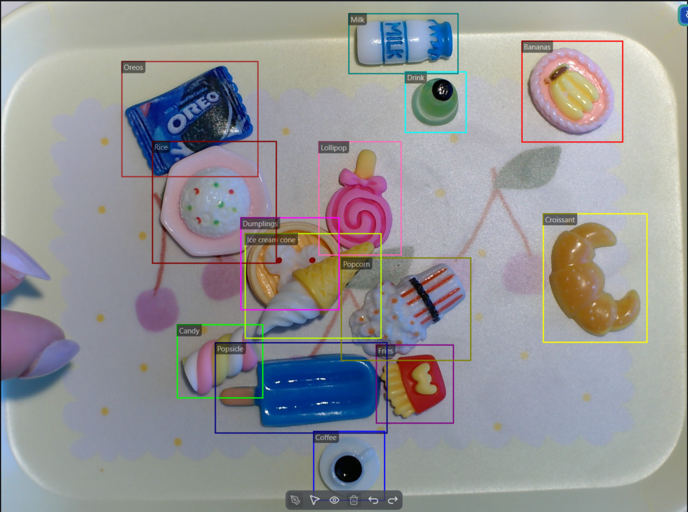

# Toy Food Conveyor Belt Detection 

This project is designed to work exclusively with DEEPCRAFT™ Studio. Download it from [here](https://softwaretools.infineon.com/assets/com.ifx.tb.tool.deepcraftstudio)

## Overview

The **Toy Food Conveyor Belt Detection Project** is a real-time object detection recognition model developed for a demo. The idea of the demo was to portray a game where the player is given a certain list of food objects and must place the correct number of each on a tray, which is then transported by a conveyor belt where model inference confirms or rejects the attempt. The model is a retrained YOLOv26n with ample data augmentation applied to the around 3400 images in the dataset. Publishing this project as a DEEPCRAFT™ Studio Accelerator is intended to showcase the tools and methods used to build and optimize an object detection model for PSOC™ Edge that works well even in very clustered scenarios. 

As with all DEEPCRAFT™ Studio Accelerators, this project can be modified to your liking but the dataset is unlikely to be useful unless you order and reuse the exact objects picked for this project, you can find the ones we used on Amazon [here.](https://www.amazon.com/Miniature-Dollhouse-Kitchen-Accessories-Tableware/dp/B0CS31XRCT/ref=sr_1_17_sspa?crid=HTM30P3UB1CD&dib=eyJ2IjoiMSJ9.qXpqNrAe73UQH-InDanKzGNYJKhRVUpTPb_fbzda_bnuqmWwMLzphIcuCmGoLiMh2wuTvp-t_0_lTKNwne9ZozDgp9Xo4s7BZfJrZkG5uJSf59sZz_xf3JoV7G06Ex-xUfhB_xak3svEghvdDlgeCDkR-lVzKJQb_jFJcKT5-I23PhCJ8L4uVPLz8UM_VlVrpHKBihh7t4WesOlvaXr1y1JC9AwyNXYNXXAb0jZJqvc.-N5gB6YR_7jb1fAtf0y-5Ff7UpknTQM6oHFhiKXIUOQ&dib_tag=se&keywords=miniature%2Bresin%2Bfood&qid=1783520873&sprefix=miniature%2Bresin%2Bfo%2Caps%2C337&sr=8-17-spons&sp_csd=d2lkZ2V0TmFtZT1zcF9tdGY&th=1) 

Be aware that not every delivery is consistent in the objects you receive.

This project is not intended to take to production, as I doubt anyone would want to detect these objects outside this demo. However, you can easily replace the data and, utilizing the methods I'll outline below, add your own objects travelling on a conveyor belt that you might want to actually take into production - or use it for your own POC.

## Contents

- **`Data`**: Contains data (3398 rgb images) collected manually for training, validation and testing the model.

- **`Models`**: Stores the trained YOLO-based model prepared for deployment on PSOC™ Edge E84 or E86. The same model can be used to generate code for either hardware target. 

- **`Resources`**: Contains a handful of images shown in the README.

## Steps to evaluate the existing model:
  
   1. Double click the existing trained `.tflite` model in the `Models` folder, this generates a GraphUX project that can be executed or used to generate code.
   2. Ensure the correct input camera is selected, and set the Bounding Box Filter to threshold=0.33 & IOU Threshold = 0.4. I also recommend increasing Max detections to 100 since this project uses many objects. 
   3. Run the Graph UX project to evaluate model performance in real time using selected camera.
   4. Place the objects on a surface to verify model performance, for this you will need the objects or potentially images of the objects linked above. 

## Steps to deploy the existing model:

   1. From the GraphUX above, click on 'Generate Source Code'
   2. Select the hardware you want, this model will not work with anything less powerful than a PSOC™ Edge E84. 
   3. Use ModusToolbox™ to deploy the model using the DEEPCRAFT Deploy Vision Code Example for PSOC™ Edge E84, following the instructions in there.
   4. Place the objects on a surface to verify model performance with a camera and screen attached to your kit. 

In my case, the model files were sent to colleagues in charge of the application code who incorporated them into a conveyor belt demo. Here is the flow of data in that final setup, including other pieces of logic and models for additional details like OCR (which are outside the scope of this model, but doable on PSOC Edge). The project repository for the demo is not publicly available at the time of this commit, but if you're interested it might be available at deepcraft.infineon.com.

## Details on how the model was created

### Collecting Data
This section covers details and logic used when creating the model and outlines known limitations of sacrifices.
This model was created without any online dataset. A suitable background tray, matching the demo requirements of size was selected and used for most of the data collection. The `Object Detection Data Collection Graph UX` template was used to collect data with predefined labels of all the objects. The camera used was an IMX335, selected for optimal performance at the range of around 32cm which was the distance considered optimal by the demo designers. The IMX335 was attached via USB and detected in DEEPCRAFT™ Studio for the collection of data and was adjusted to maximize focus at this range. Initially around 1500 images were collected and labeled, using the labeling functionality in Studio. This was compared to that of a more well known labeling in Ultralytics and concluded to be about as quick. The model was trained on this data and a couple of necessary improvements were identified such as: Adding data for varied color of objects (drink, ice cream cone & candy), adding more negative data of some other objects as well as random shapes and colors and finally collecting some more data with another tray background alongside object just on the belt and on white backgrounds. Towards the end of the project there was data collected by my colleagues using the CSI-2 interface, passing through an optimized ISP. This data was around 500 images, named "X-X_X_no_bb_frame_X" and was added to provide robustness and allow the model to run on a setup where data was collected with CSI-2 interface for the camera. 

Even with manual labeling done by myself there were some mistakes in the images - as such I manually went through all images (which can be done relatively quickly by just holding down the arrow key) to catch mistakes. Additionally I verified and modified bounding boxes to make them more tightly fit the objects, which improves model performance quite a bit. These techniques are of course quite a bit more burdensome on significantly larger datasets but are always recommended. 

### Data Augmentation Choices
Since DEEPCRAFT™ Studio uses the YOLO retraining, it also has access to utilizing the [data augmentations](https://docs.ultralytics.com/guides/yolo-data-augmentation). The following logic was applied when selecting augmentations, which are one of the most important parts to improve performance of the model:
- Degrees = 180, since objects of all angels are equally likely and expected
- Scale = 0.1, no large differences in camera distance and zoom are expected but small variances should be accounted for
- Flip left right = 0.5, similarly to degrees we expect objects to just as often be flipped
- Perspective = 0.0001, similarly to scale we add this to account for small variations in camera
- Mosaic = 0.3, this was reduced from the default since there is very small variation between objects but could be useful for occlusion. Not certain on this setting.
- Copy paste = Off, kept off since there are no rare classes 
- Hsv hue = 0.015, kept default to support the small color variation of drink, candy & ice cream cone
- Hsv value = 0.5, slightly raised to work in varied light conditions of a demo environment
- Hsv saturation = 0.7, kept default to keep variation for camera settings. Not certain on this setting.
- Translate = 0.15, slightly increased from default to catch objects with tray partially on screen. Not certain on this setting.
- Shear = 0, kept default because the viewing angle will be consistent. Not certain on this setting. 
- Flip up down = 0, kept default because rotation will be sufficient variation and upside down images are not in the scope.
- Mixup = 0.5, Set quite high to support crowded images since there will potentially be many objects on each tray.
- Bgr = 0, kept default since camera and coloration will be consistent

For selecting Data Augmentations it is important to understand your dataset and the demo environment setup in order to motivate solid choices.

YOLO26n and 320x320 resolution were selected since it was the largest resolution deployable on PSOC™ Edge E84 and the newest version of YOLO. Most comparisons have given quite negligible differences in quality between the different YOLO versions and since v26n performed well the others were not explored in this project.

### Summary of key takeaways
* Simplify and control objects and surroundings if possible
* Double check every data file to get acquianted with your dataset and catching mistakes, even if you personally labeled the dataset
* Tight bounding boxes
* Good data augmentation with solid reasoning
* Add relevant additional data after first analysis
* Deploy on device to verify consistency with laptop

## Steps to production with a conveyor belt model
This section will outline what steps you must perform to develop another Edge AI model similar to this one. We will retain the same MCU target of PSOC Edge and utilize many of the insights from the Toy Foods, but instead apply them to real objects and consider what more steps have to be taken in the journey from POC to Production.
 
### 1. POC Comparison
The first step in progressing from POC to production is to analyze the POC and see in which ways it matches the planned production-grade model. Relevant comparisons for object detection scenarios is: object's distance from the camera, number of classes the model detects, surroundings of the objects, objects for the model to ignore:

As stated above, the model is designed specifically for one camera: IMX335. But was also tested and confirmed to work nearly equally well on a common Logitech c920 Webcam. This is common for Object detection models. So long as the focus, lighting and color scheme is the same then models usually function whatever camera is used. One thing that does effect it is the distance from the camera. Objects that take up very little space are problematic: they are hard to label and due to not containing many pixels they are also very hard for the model to detect. The objects in this Toy Food project are relatively small, and so I would recommend to ensure that any objects you want to detect in your model are not much smaller than them (counted in # of pixels each object takes up on average). This is dictated both by the distance to the camera and the sizes of the images.

This model includes 16 classes of around the same amount of images. In total there are 3398 images in the project. Increasing the amount of classes requires the model to be trained on more data. 

The Toy Food Conveyor Belt Detection Model is designed for a controlled environment where users have a limited amount of objects to place on the belt. As such it was not trained on much negative data and occasionally detects random objects placed on the tray even when it shouldn't. The upside of this is that the model more easily detects correctly when the objects are obscured or shadowed. This design choice might not be what you want, since you might have an input where a large variety of objects are present you cannot forsee or have control over. If the model is to work in such a situation, make sure to add a good amount of images containing these random background items to the dataset, even if they are not labeled. Labeled images that contain an object you wish to detect, and also contains this randomness in the surrounding background are also very useful for the model. 

Similarly for the models capacity to ignore additional objects on a conveyor belt: the model must learn to adapt to different surroundings. In the Toy Food model, the background is always the same and consists of a black conveyor belt atop a white background. Due to the controlled nature of the demo it was designed for there was not much variation expected here nor added to the dataset. If your model instead is expected to function on a large host of backgrounds, be they different conveyor belt locations, different conveyor belt designs or something different from conveyor belts entirely. Capturing this variation of backgrounds in your dataset is essential for the model to learn to ignore any such context. One thing that I did to in collecting the dataset was adding some images that contained minor objects in the periphery of the conveyor belt, such as leaving my phone or the electrical cord of the motor in the frame. This was deliberate but frankly probably didn't affect the model significantly. If I suspected the background to be a bigger risk I would've added more such variation. 

### 2. Data Collection
I would recommend to throw out all the data in the project. You could of course keep it, but it would not be worth much even as negative data - for which I would recommend you collect some more relevant negative data. You might be under the impression that more data is always better, this is not the case here. YOLO is a fully trained model, and the dataset it's trained on is vast and complex. Since we're leveraging that model and just fine tuning the last layers of it we do not require a huge dataset - point proven by the project containing <3000 images. During the data collection you should start by defining a setup that can be easily repeated across locations. Having a consistent camera distance and mounting location makes it easier for the model to perform it's task and reduces the total amount of data needed by the model. Data collection can relatively easily be done by connecting a camera to your laptop and using the Object Detection Data Collection template. It can also be collected outside of Studio if there is an easier setup for that, and then imported into a project to be labeled or used. 

### 3. Data Augmentation
Once the dataset is collected, go through all the Data Augmentation parameters to figure out which alterations are relevant to your model. Here you will ask yourself questions like: "Do I expect the objects to be rotated, of different sizes, different colors, cluttered together, occluded or is a particular class very rare in the dataset?" Read up on what the different data augmentations do and in which cases they are utilized. 

### 4. Evaluation
Once you have the Data and Augmentation settings, you can train a model and evaluate it. I recommend doing this first by observing all the "Test Predictions" generated by Studio visually. (Make sure to only use the test set for evaluation or you'll be committing one of Machine Learning's greatest sins) After visually inspecting these predictions you can run the model in real time in GraphUX and deploy it on the PSOC Edge for further evaluation. In general I do not recommend looking at the provided numbers, such as mAP95 or Accuracy to get an understanding of the model performance. A model could for example place bounding boxes in generally correct locations but still get poor metrics if they do not match fully. 

During evaluation you will find reason to go back and tune your IoT Threshold and Detection Threshold parameters. These can be changed both in the project, which is then used for the evaluation and predictions generated by Studio. It can also be changed in the Bounding Box Filter node in the GraphUX project which affects the real time evaluation and the generated embedded code. 

### 5. Data Collection 2
It would be a miracle if you didn't have to do this step, so instead we shall include it in our plans. The new data you've collected and the data augmentations you've made should result in a model that performs well on most of your images. However, during the evaluation the test data you will undoubtably find situations where the model fails. Instead of outlining all the ways it could go wrong, here is a list of all the problems I found in developing the Toy Food model and how I fixed them.

- The model detected any item placed on the tray as one of the 16 defined classes. As a result I collected more data on some random objects as negative data. Additionally 3 other toy foods: Baguette, Waffle & Pretzel were chosen as part of the demo as objects which should not be detected and a good chunk of data of those was collected.
- There was found variants of the toys of different colors, specifically of Candy and Drink. These different color variants were added to the dataset, albeit in a lower quantity than the original amount.
- It was found that different orientations of the objects, specifically Candy, Drink and Milk performed poorly. These objects could either stand up or lie down and did not always perform well when standing up and the # of pixels they took up was much smaller. More data of them standing was added.
- The original core dataset consisted primarily of a tray containing 1 of each item. This involved heavy occlusion which resulted in a model that could easily differentiate between the 16 different objects. However when the model was evaluated with orders containing multiple of the same item it was found that it performed much worse. For example an order of 2 Candy and 2 Drink would perform very poorly since there was only ever one of them at a time in the dataset. This was exasperated when the two objects were touching, such as two drinks lying next to each other and touching. These objects are the same color and no instances of them being next to each other exists in the dataset. In order to solve this, the objects that could significantly lie next to each other were captured in some more data: specifically candy and drink were targeted since they commonly roll next to each other due to them being cylinders.
- Other testing teams found that model performance with different backgrounds was bad. These teams did not have the identical trays and were using white and black backgrounds for the objects. Images of the objects on three new backgrounds were selected to provide invariance to the background: White paper, conveyor belt (i.e without any tray) and a bronze bowl.
- Finally, there was a redesign of the takeaway boxes which added a new label on them. This was similar enough that the old data was not removed but some more data was added of the new box designs.

### 6. Final Test
For models going into production there should be a much more detailed and stress tested evaluation of the model. 

## Getting Started

Please visit [developer.imagimob.com](https://developer.imagimob.com), where you can read about Imagimob Studio and go through step-by-step tutorials to get you quickly started.

## Help & Support

If you need support or if you want to know how to deploy the model on to the device, please submit a ticket on the Infineon [community forum ](https://community.infineon.com/t5/Imagimob/bd-p/Imagimob/page/1) Imagimob Studio page.
