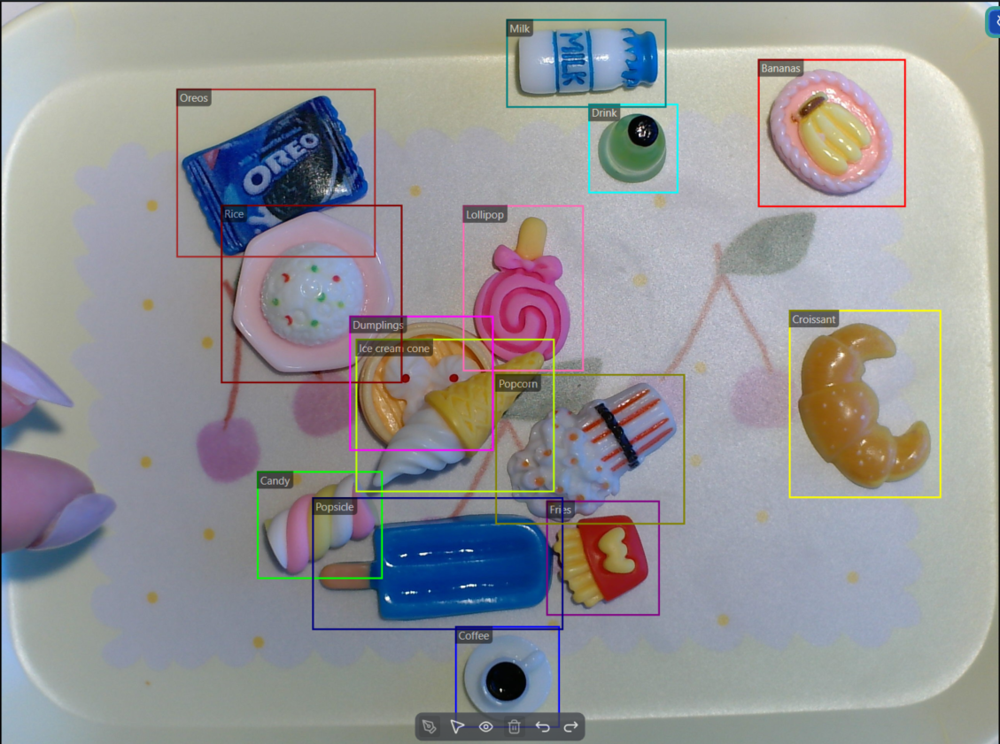

# Toy Food Conveyor Belt Detection

This project is designed to work exclusively with DEEPCRAFT™ Studio. Download it from [here](https://softwaretools.infineon.com/assets/com.ifx.tb.tool.deepcraftstudio)

## Overview - Use-Case

The **Toy Food Conveyor Belt Detection** project is a real-time object detection model developed for a demo. The idea of the demo was to portray a game where the player is given a certain list of food objects (an order) and must place the correct number of each on a tray, which is then transported by a conveyor belt where model inference confirms or rejects the attempt. The model is a retrained YOLO26n with ample data augmentation applied to the 3398 images in the dataset. Publishing this project as a DEEPCRAFT™ Studio Accelerator is intended to showcase the tools and methods used to build and optimize an object detection model for PSOC™ Edge that works well even in very clustered scenarios.

- **Machine learning method:** YOLO26n object detection trained in DEEPCRAFT™ Studio
- **Sensor and data type:** RGB camera images, from a USB IMX335 at 2592×1944 and from CSI-2 frames stored at 320×240
- **Why it matters:** Shows how to train an object detection model for PSOC™ Edge that still works when many small objects overlap on a conveyor belt

The 16 classes are 15 toy foods plus an `Edge AI Kit` box.

As with all DEEPCRAFT™ Studio Accelerators, this project can be modified to your liking but the dataset is unlikely to be useful unless you order and reuse the exact objects picked for this project, you can find the ones we used on Amazon [here](https://www.amazon.com/dp/B0CS31XRCT). Be aware that not every delivery is consistent in the objects you receive.

This project is intended as a demonstration rather than a direct production deployment, as the specific toy objects were chosen for showcase purposes. However, developers can replace the dataset with their own target objects travelling on a conveyor belt, utilizing the methods outlined below to build a proof-of-concept or production model.

## Contents

- **`Data`**: Contains data (3398 RGB images) collected manually for training, validation and testing the model. There are 3398 sessions. 2,839 are JPG images at 2592×1944, named `Images_<n>_<timestamp>`. 559 are PNG images at 320×240, named `*_no_bb_frame_*`, collected on 2026-10-08. 257 unlabeled sessions have no bounding box. Sessions are split about 70% train, 10% validation, and 20% test. No two sessions share the same image.

| Class | Sessions | Boxes |
| --- | ---: | ---: |
| Bananas | 868 | 868 |
| Candy | 1139 | 1291 |
| Coffee | 1011 | 1011 |
| Croissant | 1028 | 1028 |
| Drink | 1112 | 1235 |
| Dumplings | 830 | 830 |
| Edge AI Kit | 411 | 411 |
| Fries | 1064 | 1064 |
| Ice cream cone | 1057 | 1135 |
| Lollipop | 1075 | 1075 |
| Milk | 1025 | 1025 |
| Oreos | 1093 | 1093 |
| Popcorn | 1086 | 1086 |
| Popsicle | 1043 | 1045 |
| Rice | 716 | 716 |
| Takeaway Box | 1098 | 1099 |
| unlabeled | 257 | 257 |

- **`Models`**: Stores the trained YOLO26n model prepared for deployment on PSOC™ Edge E84. The same model can be used to generate code for either hardware target. Predictions for the trained job are stored beside it.

- **`Resources`**: Contains a handful of images shown in the README.

## Steps to evaluate the existing model

1. Double-click the trained `*.tflite` file under `Models`. This generates a Graph UX project that can be executed or used to generate code.
2. Ensure the correct input camera is selected, and set the Bounding Box Filter to a confidence threshold of 0.33 and an IoU threshold of 0.4. It is also recommended to increase Max detections to 100 since this project uses many objects. Those are the live filter settings. The training project stores a different pair: prediction confidence 0.5 and IoU 0.33.
3. Run the Graph UX project to evaluate model performance in real time using the selected camera.
4. Place the objects on a surface to verify model performance. This requires the objects, or images of the objects linked above.

## Steps to deploy the existing model

1. From the Graph UX above, click on 'Generate Source Code'.
2. Select the hardware. This model will not work with anything less powerful than a PSOC™ Edge E84.
3. Use ModusToolbox™ to deploy the model using the DEEPCRAFT Deploy Vision Code Example for PSOC™ Edge E84, following the instructions in that example.
4. Place the objects on a surface to verify model performance with a camera and screen attached to your kit.

In the demonstration setup, the model files were integrated into application code for a conveyor belt system, combining object detection with tracking and optical character recognition (OCR), which are outside the scope of this model but achievable on PSOC™ Edge. The diagram below illustrates the machine vision processing flow.

## Sensor(s) & Data

Image data is stored as DEEPCRAFT™ Studio object-detection sessions under `Data/`. Each session contains one JPG or PNG image and `LabelXml` annotations with normalized center bounding boxes (`X`, `Y`, `Width`, `Height`). The model input is 320×240×3. `ImageSize` in `ToyFoodConveyorBeltDetection.improj` is 320, so the long side of each 4:3 image becomes 320 pixels and the short side becomes 240. That is the largest input used for this PSOC™ Edge E84 model, and it matches the E86 demo poster.

The camera used for the 2592×1944 images was an IMX335, selected for optimal performance at the range of around 32cm, which was the distance considered optimal by the demo designers. The IMX335 was attached via USB. The 320×240 PNG frames were collected over CSI-2.

### Collecting Data

This section covers details and logic used when creating the model and outlines known limitations and trade-offs.

The dataset contains 3398 sessions, all collected for this project. 2,839 sessions are JPG images at 2592×1944 from an IMX335 camera attached via USB, named `Images_<n>_<timestamp>`. 559 sessions are PNG frames at 320×240, named `*_no_bb_frame_*`, collected over the CSI-2 interface and passed through an optimized ISP. No other online dataset was used.

The data was collected with the `Object Detection Data Collection Graph UX` template, using predefined labels for all the objects. A suitable background tray, matching the demo requirements of size, was selected and used for most of the collection. The IMX335 was attached via USB, detected in DEEPCRAFT™ Studio, and adjusted to maximize focus at the range of around 32cm. Initially around 1500 images were collected and labeled, using the labeling functionality in Studio. This was compared to a more well-known labeling tool in Ultralytics and concluded to be about as quick.

After the model was trained on this data, a couple of necessary improvements were identified: adding data for varied colors of objects (drink, ice cream cone, and candy), adding more negative data of some other objects as well as random shapes and colors, and collecting more data with another tray background alongside objects just on the belt and on white backgrounds. Later in the project, the 559 CSI-2 images (`*_no_bb_frame_*`) were added to provide robustness and allow the model to run on a setup where data was collected with the CSI-2 interface for the camera.

Even with manual labeling, some mistakes were found in the images. All images were therefore reviewed manually (which can be done relatively quickly by just holding down the arrow key) to catch mistakes. Bounding boxes were also verified and modified to fit the objects more tightly, which improves model performance quite a bit. These techniques are of course quite a bit more burdensome on significantly larger datasets but are always recommended.

### Data Augmentation Choices

Since DEEPCRAFT™ Studio uses the YOLO retraining, it also has access to utilizing the [data augmentations](https://docs.ultralytics.com/guides/yolo-data-augmentation). The values below are the Augmentation settings stored in `ToyFoodConveyorBeltDetection.improj`. The following logic was applied when selecting augmentations, which are one of the most important parts to improve performance of the model:

- Degrees = 180, since objects of all angles are equally likely and expected
- Scale = 0.1, no large differences in camera distance and zoom are expected but small variances should be accounted for
- Flip left right = 0.5, similarly to degrees, objects are expected to be flipped just as often
- Perspective = 0.0001, similarly to scale, this is added to account for small variations in camera
- Mosaic = 0.3, this was reduced from the default since there is very small variation between objects but could be useful for occlusion. This setting was not fully verified.
- Copy paste = 0, kept off since there are no rare classes. `CopyPasteMode` is Flip, which has no effect while copy paste is 0.
- Hsv hue = 0.015, kept default to support the small color variation of drink, candy, and ice cream cone
- Hsv value = 0.5, slightly raised to work in varied light conditions of a demo environment
- Hsv saturation = 0.7, kept default to keep variation for camera settings. This setting was not fully verified.
- Translate = 0.15, slightly increased from default to catch objects with the tray partially on screen. This setting was not fully verified.
- Shear = 0, kept default because the viewing angle will be consistent. This setting was not fully verified.
- Flip up down = 0, kept default because rotation will be sufficient variation and upside down images are not in the scope.
- Mixup = 0.5, set quite high to support crowded images since there will potentially be many objects on each tray.
- Bgr = 0, kept default since camera and coloration will be consistent

For selecting data augmentations it is important to understand your dataset and the demo environment setup in order to motivate solid choices.

YOLO26n and a 320-pixel image size (model input 320×240×3) were selected since it was the largest resolution deployable on PSOC™ Edge E84 and the newest version of YOLO. Most comparisons have given quite negligible differences in quality between the different YOLO versions and since YOLO26n performed well the others were not explored in this project.

### Summary of key takeaways

- Simplify and control objects and surroundings if possible
- Double check every data file to get acquainted with your dataset and catch mistakes, even if the dataset was labeled by the author
- Tight bounding boxes
- Good data augmentation with solid reasoning
- Add relevant additional data after first analysis
- Deploy on device to verify consistency with the laptop

## Adding More Data

You can add more data to the project following the steps below to improve detection or to include new classes. If the toy foods are not the objects for your use case, discard this dataset and collect data for those objects. The reasoning is in Steps to Production.

1. Use the `Object Detection Data Collection Graph UX` template to collect and label new data. Data collection can relatively easily be done by connecting a camera to your laptop and using the Object Detection Data Collection template.
2. Data can also be collected outside of Studio if that setup is easier, and then imported into a project to be labeled or used.
3. Import the new sessions into this project and retrain.

You can also import images that already follow the DEEPCRAFT™ Studio object-detection format: an image plus `LabelXml` annotations using normalized center coordinates (`X`, `Y`, `Width`, `Height`). See [Bring your own data for object detection projects](https://developer.imagimob.com/deepcraft-studio/data-preparation/bring-your-data/bring-your-own-data-object-detection).

## Steps to Production

This section outlines the steps to develop another Edge AI model similar to this one. The same MCU target, PSOC™ Edge, is retained, and many of the insights from the Toy Foods are used, but applied to real objects. It also considers what more steps must be taken in the journey from POC to production.

### 1. POC Comparison

The first step in progressing from POC to production is to analyze the POC and see in which ways it matches the planned production-grade model. Relevant comparisons for object detection scenarios are: the object's distance from the camera, the number of classes the model detects, the surroundings of the objects, and objects for the model to ignore.

As stated above, the model is designed specifically for one camera: IMX335. But it was also tested and confirmed to work nearly equally well on a common Logitech c920 webcam. This is common for object detection models. So long as the focus, lighting, and color scheme are the same, these models usually function with whatever camera is used. One thing that does affect it is the distance from the camera. Objects that take up very little space are problematic: they are hard to label and due to not containing many pixels they are also very hard for the model to detect. The objects in this Toy Food project are relatively small, and so it is recommended to ensure that any objects to be detected in a model are not much smaller than them (counted in number of pixels each object takes up on average). This is dictated both by the distance to the camera and the sizes of the images.

This model includes 16 classes. In total there are 3398 images in the project. Counts are similar for most toy foods; `Edge AI Kit` and `Rice` have fewer. Increasing the amount of classes requires the model to be trained on more data.

The Toy Food Conveyor Belt Detection model is designed for a controlled environment where users have a limited amount of objects to place on the belt. As such it was not trained on much negative data and occasionally detects random objects placed on the tray even when it should not. The upside of this is that the model more easily detects correctly when the objects are obscured or shadowed. This design choice might not be what you want, since you might have an input where a large variety of objects are present you cannot foresee or have control over. If the model is to work in such a situation, make sure to add a good amount of images containing these random background items to the dataset, even if they are not labeled. Labeled images that contain an object you wish to detect, and also contain this randomness in the surrounding background, are also very useful for the model.

Similarly for the model's capacity to ignore additional objects on a conveyor belt, the model must learn to adapt to different surroundings. In the Toy Food model, the usual background is a black conveyor belt on a white surface, with the objects on a tray. The demo was controlled, so only a few other backgrounds were added. Those are listed under Second Round of Data Collection. If your model instead is expected to function on a large host of backgrounds, be they different conveyor belt locations, different conveyor belt designs, or something different from conveyor belts entirely, capturing this variation of backgrounds in your dataset is essential for the model to learn to ignore any such context. One thing done while collecting the dataset was adding some images that contained minor objects in the periphery of the conveyor belt, such as a phone or the electrical cord of the motor in the frame. This was deliberate but probably did not affect the model significantly. Had the background been considered a bigger risk, more such variation would have been added.

### 2. Data Collection

Since this project was created as a toy demo, its data can be discarded. It would not really be useful even as negative data for a real case project. After defining your use case and application, collect as many images as possible of your objects moving on a conveyor belt or similar, covering all possible scenarios, such as different lighting, object orientations, objects touching or overlapping, varied backgrounds, and random items that should be ignored. YOLO is a fully trained model, and this project only fine-tunes its last layers, so fewer images are needed than when training from scratch, but the images should still cover every scenario the model will face. Before collecting, define a setup that can be easily repeated across locations. A consistent camera distance and mounting location makes it easier for the model to perform its task and reduces the total amount of data it needs. Data can be collected by connecting a camera to a laptop and using the Object Detection Data Collection template in DEEPCRAFT™ Studio. Data can also be collected outside of Studio if that setup is easier, and then imported into a project to be labeled or used.

### 3. Data Augmentation

Once the dataset is collected, go through all the data augmentation parameters to figure out which alterations are relevant to your model. Here you will ask yourself questions like: "Do I expect the objects to be rotated, of different sizes, different colors, cluttered together, occluded, or is a particular class very rare in the dataset?" Read up on what the different data augmentations do and in which cases they are utilized.

### 4. Evaluation

Once the data and augmentation settings are ready, a model can be trained and evaluated. Evaluation includes visually inspecting the predictions in all sets, with particular focus on the test set if images were added to test the model's generalization. This inspection indicates the situations where the model fails. After that, the model can be run in real time in Graph UX, and/or deployed on the PSOC™ Edge for further evaluation. The provided metrics, such as mAP95 or accuracy, are not recommended as the sole way to understand model performance. A model can, for example, place bounding boxes in generally correct locations and still get poor metrics if they do not match fully.

During evaluation, it may be necessary to revisit and tune the IoU threshold and detection threshold parameters. These can be changed both in the project, which is then used for the evaluation and predictions generated by Studio. They can also be changed in the Bounding Box Filter node in the Graph UX project, which affects the real time evaluation and the generated embedded code.

### 5. Second Round of Data Collection

A second round of data collection is almost always required in practice. While initial data collection and augmentation typically produce a model that performs well across most images, test evaluation will reveal scenarios where the model fails. Below are the key issues encountered during the development of the Toy Food model and how they were addressed:

- Every item placed on the tray was detected as one of the 16 classes. Additional images of unrelated objects were collected as negative data. Three further toy foods, Baguette, Waffle, and Pretzel, were included in the demo as objects that should not be detected, and a substantial set of those images was collected. They were not given class names. Images with no object to detect are the 257 unlabeled sessions.
- Color variants of Candy and Drink were found after the first collection. Those variants were added to the dataset, in a smaller quantity than the original colors.
- Candy, Drink, and Milk performed poorly in some orientations. Each of these objects can stand or lie down, and detection was weaker when they stood, because they occupied fewer pixels. Additional images of them standing were collected.
- The first dataset was mostly one of each item on a tray. Occlusion in those images produced a model that could distinguish the 16 classes, but orders with several copies of the same item performed much worse in the demo game. An order of two Candy and two Drink was a clear case, because the dataset contained only one of each at a time. Performance dropped further when two objects touched, such as two drinks lying side by side. They are the same color, and the dataset had no examples of them next to each other. Additional images were collected of objects that commonly lie together, in particular Candy and Drink, which roll against each other because they are cylinders.
- Performance was poor on backgrounds other than the original tray. Other test setups used white and black surfaces instead of the same tray. Images on three further backgrounds were added so the model would not depend on that tray: white paper, the conveyor belt without a tray, and a bronze bowl.
- The takeaway boxes were later redesigned with a new label. The new design was close enough to the old one that the original images were kept, and additional images of the new boxes were added.

### 6. Final Test

For models going into production there should be a much more detailed and stress-tested evaluation of the model. On a conveyor, check that each object is detected for as long as it stays in view, including when objects touch, overlap, or sit partly outside the frame. Compare the count of each class with a known load on the tray or belt, because a correct detection with the wrong quantity still fails the use case. Repeat the test at the belt speeds, lighting, and camera distances used in production, and include items that must be ignored. On the target hardware, confirm that a result is ready before the object moves out of the camera view.

## Attributions & Citations

Images in this project were collected for the accelerator using an IMX335 camera over USB and a CSI-2 camera, for toy food and a PSOC™ Edge AI Kit box on a conveyor belt. Usage is subject to the [DEEPCRAFT™ Studio Terms and Conditions](https://developer.imagimob.com/legal/studio-terms-and-conditions).

## Getting Started

Please visit [developer.imagimob.com](https://developer.imagimob.com), where you can read about DEEPCRAFT™ Studio and go through step-by-step tutorials to get you quickly started.

For object-detection data formats, see [Bring your own data for object detection projects](https://developer.imagimob.com/deepcraft-studio/data-preparation/bring-your-data/bring-your-own-data-object-detection).

## Help & Support

If you need support or if you want to know how to deploy the model onto the device, please submit a ticket on the Infineon [community forum](https://community.infineon.com/t5/Imagimob/bd-p/Imagimob/page/1) DEEPCRAFT™ Studio page.
